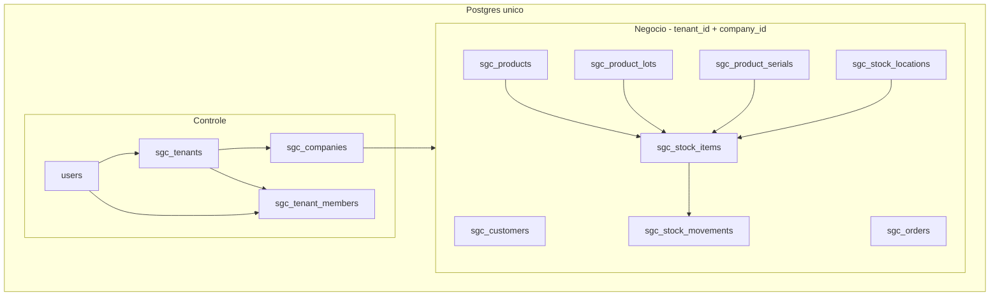

# Módulo SGC — Sistema de Gestão Comercial

Documentação de implementação do **SGC** (*Sistema de Gestão Comercial*): clientes, produtos, estoque e vendas para pequenos comércios.

## Protocolo de uso

1. Diga **"implemente a fase N"** (0 a 6).
2. Leia, nesta ordem:
   - `docs/sgc/phase-N-*.md` (roteiro da fase)
   - `docs/sgc/schema.md` (schema de referência)
   - `docs/sgc/conventions.md` (padrões obrigatórios do projeto)
3. Implemente **apenas** o escopo da fase. Respeite a seção **Fora do escopo** de cada documento.
4. Valide contra os **critérios de aceite** da fase.
5. Marque a fase como concluída na tabela de status abaixo.

## Status das fases

| Fase | Documento | Status |
|------|-----------|--------|
| 0 | [phase-0-tenant-infra.md](phase-0-tenant-infra.md) | concluída |
| 1 | [phase-1-companies-members.md](phase-1-companies-members.md) | pendente |
| 2 | [phase-2-customers.md](phase-2-customers.md) | pendente |
| 3 | [phase-3-catalog.md](phase-3-catalog.md) | pendente |
| 4 | [phase-4-stock.md](phase-4-stock.md) | pendente |
| 5 | [phase-5-orders.md](phase-5-orders.md) | pendente |
| 6 | [phase-6-offline-readonly.md](phase-6-offline-readonly.md) | pendente |

## Visão geral

SGC (*Sistema de Gestão Comercial*) multi-tenant acessível em `/sgc`, registrado como ferramenta em `resources/js/Data/tools.js`.

- Um **usuário-dono** pode ter **N empresas/filiais**.
- Membros convidados (`admin`, `seller`) usam o **login normal** do site — não há segundo sistema de auth.
- **Todos os dados** (controle e negócio) ficam no **Postgres único**, com isolamento por `tenant_id` + `company_id`.
- Tabelas prefixadas `sgc_` para evitar colisão com tabelas do site.
- Produtos com três modos de rastreio: fungível (`none`), por lote/rolo (`lot`) ou por unidade (`serial`).
- Quantidades fracionadas (`numeric`) com unidade de medida de venda (`kg`, `L`, `m`, `un`, etc.).
- Estoque: saldo mutável em `sgc_stock_items`, histórico append-only em `sgc_stock_movements`, identidade em lotes e seriais.
- Endereçamento opcional (`sgc_stock_locations`).
- **Offline (Fase 6):** sem conexão, o SGC entra em modo **somente leitura** — consultas via cache local, sem criar/editar/excluir.

## Arquitetura: Postgres único



### Controle (`sgc_tenants`, `sgc_companies`, `sgc_tenant_members`)

Metadados de autorização e estrutura organizacional:

- `sgc_tenants` — um registro por usuário-dono.
- `sgc_companies` — empresas/filiais do tenant (endereço inline).
- `sgc_tenant_members` — quem pode acessar o tenant e com qual papel.

### Negócio (tabelas `sgc_*` com `tenant_id` + `company_id`)

Dados operacionais com FKs reais entre si e para o controle. Isolamento entre empresas via coluna `company_id` + trait `BelongsToCompany`; isolamento entre tenants via `tenant_id` + trait `BelongsToTenant`.

### Fluxo de acesso

1. Login em `/login`.
2. Usuário acessa `/sgc`.
3. Sistema lista tenants onde ele é membro.
4. Usuário escolhe tenant + empresa; sessão guarda `sgc_tenant_id` e `sgc_company_id`.
5. Middleware `tenant` (`ResolveTenantContext`) valida membership, popula `SGCContext` e aplica global scopes.

## Entidades por fase

| Fase | Entidades |
|------|-----------|
| 0 | Infra (sgc_tenants, sgc_companies, sgc_tenant_members; SGCContext; traits; RLS recomendado) |
| 1 | UI de empresas e membros |
| 2 | sgc_customers, sgc_customer_addresses |
| 3 | sgc_product_categories, sgc_product_brands, sgc_products |
| 4 | sgc_stock_locations, sgc_product_lots, sgc_product_serials, sgc_stock_items, sgc_stock_movements |
| 5 | sgc_orders, sgc_order_items (+ FK adiada order_item_id na Fase 4) |
| 6 | Cache IndexedDB (navegador); modo somente leitura offline |

## Decisões e riscos (Postgres único)

Decisão consciente. Mitigações documentadas; não rediscutir a cada fase.

| Risco | Mitigação |
|-------|-----------|
| Query sem escopo vaza dados | Traits `BelongsToTenant` + `BelongsToCompany`; RLS recomendado na Fase 0; testes de isolamento |
| Vizinho ruidoso (I/O compartilhado) | Índices em `(tenant_id, company_id)`; monitorar queries lentas |
| Cotas por tenant | `TenantLimit::records()` checado nos Form Requests (contagem de linhas, não tamanho de arquivo) |
| Backup | `pg_dump` do banco único (não mais VACUUM INTO por tenant) |
| Relatórios cross-tenant | Possível no MVP (query admin com escopo explícito) |
| Jobs sem sessão | Todo job recebe `tenant_id` + `company_id` e chama `SGCContext::set()` |
| Dinheiro | Sempre `integer` (centavos), nunca `float` |
| Quantidade | Sempre `numeric(12,3)` em saldo/movimentos/pedidos; unidade de venda em `products.unit` |
| Estoque | Saldo em `sgc_stock_items`; kardex append-only; reconciliação via `sgc:stock:reconcile` |
| Deploy | `php artisan migrate` único — sem `tenant:migrate` |

## Documentos de referência

- [schema.md](schema.md) — tabelas, tipos, constraints e invariantes
- [conventions.md](conventions.md) — padrões de backend e frontend do projeto

## Ordem obrigatória

```
Fase 0 → Fase 1 → Fase 2 → Fase 3 → Fase 4 → Fase 5 → Fase 6
```

- Fase 2 depende do contexto de tenant/empresa selecionado (Fase 1).
- Fase 4 depende do catálogo (Fase 3).
- Fase 5 depende do estoque (Fase 4) e resolve FKs adiadas.
- Fase 6 depende do SGC online completo (Fase 5); adiciona consulta offline sem escrita.
